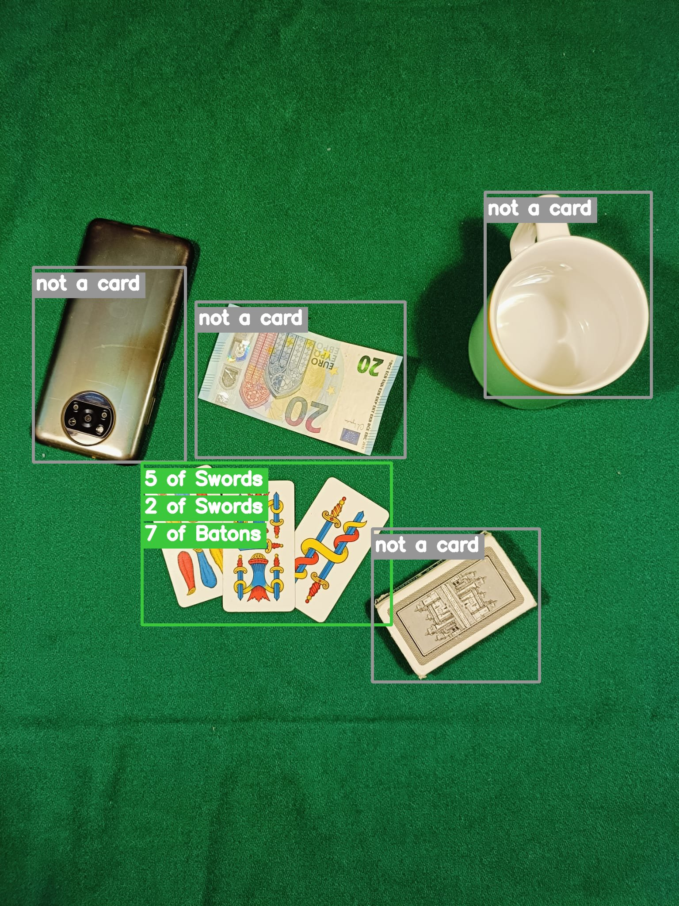
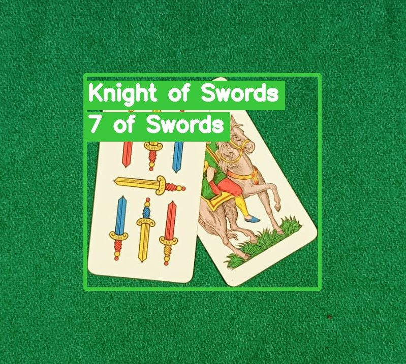

# Playing Cards Recognition

Recognising Italian regional playing cards (40-card deck: Cups, Coins, Swords and Batons) in cluttered table scenes with classical computer vision: background modelling, blob analysis and local feature matching. No deep learning is involved.

Course project for *Computer Vision and Image Processing*, Automation Engineering, University of Bologna (2024).

<table>
  <tr>
    <td align="center" width="55%"></td>
    <td align="center" width="45%"></td>
  </tr>
  <tr>
    <td align="center"><sub>Three fanned cards recognised; phone, banknote, mug and card box rejected</sub></td>
    <td align="center"><sub>Overlapping cards separated by feature matching</sub></td>
  </tr>
</table>

## Pipeline

1. **Background model:** fit a Gaussian (mean and covariance in RGB) to an image of the empty green table.
2. **Segmentation:** compute the per-pixel Mahalanobis distance from the background model, threshold it, then clean up with morphology to get a foreground mask.
3. **Blob analysis:** connected components with size filtering isolate candidate objects such as cards, phone and mug.
4. **Reference deck:** each of the 40 reference cards is segmented the same way and described with ORB, SIFT or AKAZE keypoints.
5. **Matching:** match every blob against every deck card with k-NN (brute-force or FLANN), Lowe's ratio test, and a reverse ratio test plus cross-check for mutual consistency. The keypoint budget scales with the blob's area.
6. **Decision:** a card is reported when its match count beats both an absolute threshold and a confidence relative to the best match. Distractor objects score low and are rejected.

Each run is scored against ground-truth labels (cards found, correct, missed, confidence margins, run time), and the results plus parameters are written to `results.xlsx` for parameter sweeps.

## Running

```bash
pip install -r requirements.txt
python main_work.py            # sequential version
python main_work_threads.py    # multithreaded matching
```

Parameters (segmentation threshold, detector, matcher, ratio-test thresholds, confidence) are set at the top of the parameters section in each script.

To render annotated detection images like the ones above (written to `results/`):

```bash
python render_detections.py 5 9    # test scene numbers
```

## Structure

| Path | Contents |
|---|---|
| `main_work.py` / `main_work_threads.py` | Full pipeline and evaluation (sequential or threaded) |
| `images/` | Photos of the 40 reference cards |
| `deck/` | Segmented and cropped reference cards (generated from `images/`) |
| `test_images/` | Test scenes, including overlapping, rotated and distorted cards plus distractors, and the background image |
| `render_detections.py` | Draws per-blob detections on test scenes using the same pipeline and parameters |
| `results/` | Annotated detection images |
| `results.xlsx` | Logged metrics and parameters for each run |
| `archive/` | Earlier development versions |

## Authors

- Francesco Cenni ([@Frasco-eng](https://github.com/Frasco-eng))
- Giulio Mazzaroppi ([@Giulio-Mazzar](https://github.com/Giulio-Mazzar))
- Giacomo Pezzolati ([@giacomo2k2](https://github.com/giacomo2k2))

## License

[MIT](LICENSE)
